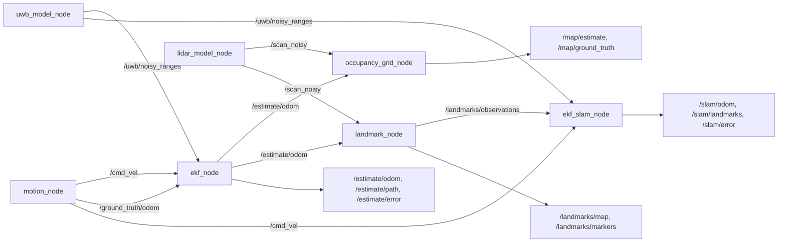

# Architecture

**English** | [Русский](../ru/architecture.md)

This document describes how the Navigator-M workspace is organised: package
responsibilities, runtime data flow, coordinate frames, nodes, topics and
launch composition.

## Design principles

- **Pure algorithms, thin ROS wrappers.** The filters and geometry live in
  modules that do not import ROS, so they can be unit-tested directly.
- **One source of truth for the scene.** `navigator_sim/world.py` defines the
  arena, obstacles, anchors, landmarks and sensor offsets. The marker
  publisher, lidar model and tests all import it.
- **Simulator as a replaceable data source.** Localization and SLAM consume
  ordinary ROS topics. Replacing `navigator_sim` with real drivers should not
  require changes in the filtering packages.
- **Bringup is the only composition layer.** `navigator_bringup` decides which
  nodes run together; packages do not launch each other.

## Packages

| Package | Role | Key modules |
|---|---|---|
| `navigator_description` | Robot model and RViz layout. | `urdf/navigator_m.urdf`, `config/navigator.rviz` |
| `navigator_sim` | Scene geometry, ground-truth motion and sensor models. | `world.py`, `motion_node.py`, `uwb_model_node.py`, `lidar_model_node.py`, `polygon_markers_node.py` |
| `navigator_localization` | EKF localization from UWB ranges. | `ekf.py`, `ekf_node.py` |
| `navigator_slam` | Occupancy grid, landmark detection and joint EKF-SLAM. | `occupancy_grid.py`, `landmark_detection.py`, `tentative.py`, `ekf_slam.py` and their ROS nodes |
| `navigator_interfaces` | Messages for landmark observations and maps. | `msg/*.msg` |
| `navigator_bringup` | Launch files that assemble the stack. | `launch/*.launch.py` |
| `tools/` | Offline analysis and plotting. | `visualize.py`, `localization_metrics.py`, `map_compare.py`, `analysis.py` |

The dependency direction is deliberate: `navigator_sim` and
`navigator_localization` do not depend on each other, `navigator_slam` depends
on `navigator_interfaces`, and `navigator_bringup` depends on all runtime
packages.

## Runtime data flow

The same lidar scans feed two mappers when `mapping.launch.py
pose_source:=both` is used: one consumes `/estimate/odom`, the other
`/ground_truth/odom`. This isolates pose error from scan noise.

## Coordinate frames

| Frame | Parent | Published by | Meaning |
|---|---|---|---|
| `map` | — | static transform or SLAM convention | Fixed world frame. |
| `odom` | `map` | `static_transform_publisher` | Simulation odometry frame; identity relative to `map`. |
| `base_footprint` | `odom` | `motion_node` | Ground-truth planar robot pose. |
| `base_link` | `base_footprint` | `robot_state_publisher` | Robot body frame. |
| `lidar_link` | `base_link` | `robot_state_publisher` | Lidar frame at `(0.18, 0, 0.34)`. |
| `uwb_tag_link` | `base_link` | `robot_state_publisher` | UWB tag frame at `(-0.15, 0.12, 0.46)`. |

Important properties:

- `map -> odom` is a fixed identity transform in the simulator.
- `odom -> base_footprint` is owned by `motion_node` and carries ground truth.
- `ekf_node` and `ekf_slam_node` publish poses on topics but do not broadcast
  TF, so there is no transform conflict.
- Occupancy mapping and landmark detection treat incoming poses as already
  expressed in `map`; they do not perform TF lookups.

On a real robot, `map -> odom` would normally be produced by the SLAM or
localization stack, and `odom -> base_footprint` by wheel odometry.

## Nodes

| Node | Package | Subscribes | Publishes |
|---|---|---|---|
| `robot_state_publisher` | — | `/joint_states` | `/robot_description`, `/tf`, `/tf_static` |
| `joint_state_publisher` | — | — | `/joint_states` |
| `static_transform_publisher` | `tf2_ros` | — | `/tf_static` |
| `motion_node` | `navigator_sim` | — | `/ground_truth/odom`, `/ground_truth/path`, `/cmd_vel`, `/joint_states`, TF |
| `polygon_markers` | `navigator_sim` | — | `/polygon_markers` |
| `uwb_model_node` | `navigator_sim` | — | `/uwb/ideal_ranges`, `/uwb/noisy_ranges`, `/uwb/anchors` |
| `lidar_model_node` | `navigator_sim` | — | `/scan_ideal`, `/scan_noisy` |
| `ekf_node` | `navigator_localization` | `/cmd_vel`, `/uwb/noisy_ranges`, `/ground_truth/odom` | `/estimate/odom`, `/estimate/path`, `/estimate/error` |
| `occupancy_grid_node` | `navigator_slam` | `/scan_noisy`, pose topic | map topic |
| `landmark_node` | `navigator_slam` | `/scan_noisy`, pose topic | `/landmarks/observations`, `/landmarks/map`, `/landmarks/markers` |
| `ekf_slam_node` | `navigator_slam` | `/cmd_vel`, `/uwb/noisy_ranges`, `/landmarks/observations`, `/ground_truth/odom` | `/slam/odom`, `/slam/path`, `/slam/landmarks`, `/slam/markers`, `/slam/error` |

`occupancy_grid_node` is started under two names: `occupancy_grid_ekf` for
`/estimate/odom` and `occupancy_grid_gt` for `/ground_truth/odom`.

## Topics

| Topic | Type | Direction |
|---|---|---|
| `/ground_truth/odom`, `/ground_truth/path` | `nav_msgs/Odometry`, `nav_msgs/Path` | simulator output |
| `/cmd_vel` | `geometry_msgs/Twist` | simulator output and filter input |
| `/joint_states` | `sensor_msgs/JointState` | simulator output |
| `/scan_ideal`, `/scan_noisy` | `sensor_msgs/LaserScan` | simulator output |
| `/uwb/ideal_ranges`, `/uwb/noisy_ranges` | `std_msgs/Float32MultiArray` | simulator output |
| `/uwb/anchors`, `/polygon_markers` | `visualization_msgs/MarkerArray` | visualization output |
| `/estimate/odom`, `/estimate/path` | `nav_msgs/Odometry`, `nav_msgs/Path` | localization output |
| `/estimate/error` | `geometry_msgs/Vector3Stamped` | localization diagnostics |
| `/map/estimate`, `/map/ground_truth` | `nav_msgs/OccupancyGrid` | mapping output |
| `/landmarks/observations` | `navigator_interfaces/LandmarkObservationArray` | detector output |
| `/landmarks/map` | `navigator_interfaces/LandmarkMap` | tracker output |
| `/landmarks/markers` | `visualization_msgs/MarkerArray` | visualization output |
| `/slam/odom`, `/slam/path` | `nav_msgs/Odometry`, `nav_msgs/Path` | SLAM output |
| `/slam/landmarks` | `navigator_interfaces/LandmarkMap` | SLAM output |
| `/slam/markers` | `visualization_msgs/MarkerArray` | visualization output |
| `/slam/error` | `geometry_msgs/Vector3Stamped` | SLAM diagnostics |
| `/tf`, `/tf_static` | `tf2_msgs/TFMessage` | transforms |

## Launch composition

| Launch file | Starts | Key arguments |
|---|---|---|
| `display.launch.py` | `robot_state_publisher`, `joint_state_publisher`, static `map -> base_footprint`, polygon markers, RViz | `use_rviz` |
| `simulation.launch.py` | Robot state, static `map -> odom`, motion, polygon, UWB, lidar, optional EKF and RViz | `use_rviz`, `use_localization`, `sensors_params`, `ekf_params` |
| `localization.launch.py` | `simulation.launch.py` with `use_localization:=true` | `use_rviz` |
| `mapping.launch.py` | Simulation plus one or two occupancy mappers | `use_rviz`, `pose_source`, `sensors_params`, `ekf_params` |
| `landmarks.launch.py` | Simulation with EKF plus `landmark_node` | `use_rviz`, `pose_topic` |
| `slam.launch.py` | Simulation without EKF, `landmark_node` with empty pose topic, `ekf_slam_node` | `use_rviz` |

## Extension points

- Replace `navigator_sim` with real sensor drivers while keeping the same topic
  names.
- Replace the EKF localizer with another source of `/estimate/odom`.
- Add a new mapping or SLAM node that consumes the existing pose, scan and
  landmark topics.
- Add worlds and landmark layouts by extending `world.py` and the YAML files.
- Reuse the pure Python modules without ROS in offline evaluation scripts.

## Related documentation

- [ROS API](ros-api.md) — nodes, topics, messages, frames, parameters and
  launch arguments.
- [Configuration](configuration.md) — all YAML parameters and defaults.
- [Algorithms](algorithms.md) — EKF, occupancy grid, landmark detection and
  EKF-SLAM.
- [Verification](verification.md) — tests and runtime checks.
- [Troubleshooting](troubleshooting.md) — common runtime problems.
