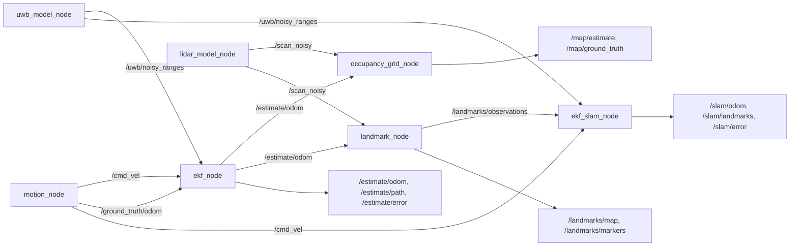

# Архитектура

[English](../en/architecture.md) | **Русский**

В документе описано устройство рабочего пространства Navigator-M: роли пакетов,
поток данных во время работы, системы координат, узлы, топики и состав
launch-файлов.

## Принципы проектирования

- **Чистые алгоритмы, тонкие ROS-обёртки.** Фильтры и геометрия живут в
  модулях, которые не импортируют ROS, поэтому их можно тестировать
  unit-тестами напрямую.
- **Единый источник истины для сцены.** `navigator_sim/world.py` определяет
  арену, препятствия, якоря, ориентиры и смещения датчиков. Издатель маркеров,
  модель лидара и тесты импортируют его.
- **Симулятор как заменяемый источник данных.** Локализация и SLAM потребляют
  обычные топики ROS. Замена `navigator_sim` на реальные драйверы не должна
  требовать изменений в пакетах фильтрации.
- **Bringup — единственный слой композиции.** `navigator_bringup` решает, какие
  узлы запускаются вместе; пакеты не запускают друг друга.

## Пакеты

| Пакет | Роль | Ключевые модули |
|---|---|---|
| `navigator_description` | Модель робота и конфигурация RViz. | `urdf/navigator_m.urdf`, `config/navigator.rviz` |
| `navigator_sim` | Геометрия сцены, истинное движение и модели датчиков. | `world.py`, `motion_node.py`, `uwb_model_node.py`, `lidar_model_node.py`, `polygon_markers_node.py` |
| `navigator_localization` | EKF-локализация по дальностям СШП. | `ekf.py`, `ekf_node.py` |
| `navigator_slam` | Сетка занятости, выделение ориентиров и совместный EKF-SLAM. | `occupancy_grid.py`, `landmark_detection.py`, `tentative.py`, `ekf_slam.py` и их ROS-узлы |
| `navigator_interfaces` | Сообщения наблюдений ориентиров и карт. | `msg/*.msg` |
| `navigator_bringup` | Launch-файлы, собирающие стек. | `launch/*.launch.py` |
| `tools/` | Офлайн-анализ и построение графиков. | `visualize.py`, `localization_metrics.py`, `map_compare.py`, `analysis.py` |

Направление зависимостей выбрано намеренно: `navigator_sim` и
`navigator_localization` не зависят друг от друга, `navigator_slam` зависит
от `navigator_interfaces`, а `navigator_bringup` — от всех runtime-пакетов.

## Поток данных во время работы

При использовании `mapping.launch.py pose_source:=both` одни и те же сканы
лидара подаются в два картографа: один использует `/estimate/odom`, другой —
`/ground_truth/odom`. Это позволяет отделить ошибку позы от шума сканов.

## Системы координат

| Система координат | Родительская | Публикует | Назначение |
|---|---|---|---|
| `map` | — | статическая трансформация или соглашение SLAM | Фиксированная мировая система координат. |
| `odom` | `map` | `static_transform_publisher` | Система координат одометрии симулятора; единичная относительно `map`. |
| `base_footprint` | `odom` | `motion_node` | Истинная планарная поза робота. |
| `base_link` | `base_footprint` | `robot_state_publisher` | Система координат корпуса робота. |
| `lidar_link` | `base_link` | `robot_state_publisher` | Система координат лидара в точке `(0.18, 0, 0.34)`. |
| `uwb_tag_link` | `base_link` | `robot_state_publisher` | Система координат СШП-метки в точке `(-0.15, 0.12, 0.46)`. |

Важные свойства:

- В симуляторе `map -> odom` — фиксированная единичная трансформация.
- `odom -> base_footprint` принадлежит `motion_node` и содержит истинную позу.
- `ekf_node` и `ekf_slam_node` публикуют позы в топики, но не транслируют TF,
  поэтому конфликта трансформаций нет.
- Построение сетки занятости и выделение ориентиров считают входящие позы уже
  заданными в `map`; они не выполняют запросов TF.

На реальном роботе `map -> odom` обычно формирует стек SLAM или локализации,
а `odom -> base_footprint` — одометрия колёс.

## Узлы

| Узел | Пакет | Подписки | Публикации |
|---|---|---|---|
| `robot_state_publisher` | — | `/joint_states` | `/robot_description`, `/tf`, `/tf_static` |
| `joint_state_publisher` | — | — | `/joint_states` |
| `static_transform_publisher` | `tf2_ros` | — | `/tf_static` |
| `motion_node` | `navigator_sim` | — | `/ground_truth/odom`, `/ground_truth/path`, `/cmd_vel`, `/joint_states`, TF |
| `polygon_markers` | `navigator_sim` | — | `/polygon_markers` |
| `uwb_model_node` | `navigator_sim` | — | `/uwb/ideal_ranges`, `/uwb/noisy_ranges`, `/uwb/anchors` |
| `lidar_model_node` | `navigator_sim` | — | `/scan_ideal`, `/scan_noisy` |
| `ekf_node` | `navigator_localization` | `/cmd_vel`, `/uwb/noisy_ranges`, `/ground_truth/odom` | `/estimate/odom`, `/estimate/path`, `/estimate/error` |
| `occupancy_grid_node` | `navigator_slam` | `/scan_noisy`, топик позы | топик карты |
| `landmark_node` | `navigator_slam` | `/scan_noisy`, топик позы | `/landmarks/observations`, `/landmarks/map`, `/landmarks/markers` |
| `ekf_slam_node` | `navigator_slam` | `/cmd_vel`, `/uwb/noisy_ranges`, `/landmarks/observations`, `/ground_truth/odom` | `/slam/odom`, `/slam/path`, `/slam/landmarks`, `/slam/markers`, `/slam/error` |

`occupancy_grid_node` запускается под двумя именами: `occupancy_grid_ekf` —
для `/estimate/odom` и `occupancy_grid_gt` — для `/ground_truth/odom`.

## Топики

| Топик | Тип | Направление |
|---|---|---|
| `/ground_truth/odom`, `/ground_truth/path` | `nav_msgs/Odometry`, `nav_msgs/Path` | выход симулятора |
| `/cmd_vel` | `geometry_msgs/Twist` | выход симулятора и вход фильтра |
| `/joint_states` | `sensor_msgs/JointState` | выход симулятора |
| `/scan_ideal`, `/scan_noisy` | `sensor_msgs/LaserScan` | выход симулятора |
| `/uwb/ideal_ranges`, `/uwb/noisy_ranges` | `std_msgs/Float32MultiArray` | выход симулятора |
| `/uwb/anchors`, `/polygon_markers` | `visualization_msgs/MarkerArray` | выход визуализации |
| `/estimate/odom`, `/estimate/path` | `nav_msgs/Odometry`, `nav_msgs/Path` | выход локализации |
| `/estimate/error` | `geometry_msgs/Vector3Stamped` | диагностика локализации |
| `/map/estimate`, `/map/ground_truth` | `nav_msgs/OccupancyGrid` | выход картографа |
| `/landmarks/observations` | `navigator_interfaces/LandmarkObservationArray` | выход детектора |
| `/landmarks/map` | `navigator_interfaces/LandmarkMap` | выход трекера |
| `/landmarks/markers` | `visualization_msgs/MarkerArray` | выход визуализации |
| `/slam/odom`, `/slam/path` | `nav_msgs/Odometry`, `nav_msgs/Path` | выход SLAM |
| `/slam/landmarks` | `navigator_interfaces/LandmarkMap` | выход SLAM |
| `/slam/markers` | `visualization_msgs/MarkerArray` | выход визуализации |
| `/slam/error` | `geometry_msgs/Vector3Stamped` | диагностика SLAM |
| `/tf`, `/tf_static` | `tf2_msgs/TFMessage` | трансформации |

## Состав launch-файлов

| Launch-файл | Запускает | Ключевые аргументы |
|---|---|---|
| `display.launch.py` | `robot_state_publisher`, `joint_state_publisher`, статическую `map -> base_footprint`, маркеры полигона, RViz | `use_rviz` |
| `simulation.launch.py` | Состояние робота, статическую `map -> odom`, движение, полигон, СШП, лидар, опциональный EKF и RViz | `use_rviz`, `use_localization`, `sensors_params`, `ekf_params` |
| `localization.launch.py` | `simulation.launch.py` с `use_localization:=true` | `use_rviz` |
| `mapping.launch.py` | Симуляцию плюс один или два картографа сетки занятости | `use_rviz`, `pose_source`, `sensors_params`, `ekf_params` |
| `landmarks.launch.py` | Симуляцию с EKF плюс `landmark_node` | `use_rviz`, `pose_topic` |
| `slam.launch.py` | Симуляцию без EKF, `landmark_node` с пустым топиком позы, `ekf_slam_node` | `use_rviz` |

## Точки расширения

- Заменить `navigator_sim` реальными драйверами датчиков, сохранив те же имена
  топиков.
- Заменить EKF-локализатор другим источником `/estimate/odom`.
- Добавить новый узел картографирования или SLAM, который использует
  существующие топики позы, сканов и ориентиров.
- Добавлять полигоны и раскладки ориентиров, расширяя `world.py` и YAML-файлы.
- Переиспользовать чистые Python-модули без ROS в офлайн-скриптах оценки.

## Связанная документация

- [ROS API](ros-api.md) — узлы, топики, сообщения, системы координат,
  параметры и аргументы launch-файлов.
- [Конфигурация](configuration.md) — все параметры YAML и значения по
  умолчанию.
- [Алгоритмы](algorithms.md) — EKF, сетка занятости, выделение ориентиров и
  EKF-SLAM.
- [Проверка](verification.md) — тесты и runtime-проверки.
- [Проблемы и решения](troubleshooting.md) — типичные проблемы при работе.
